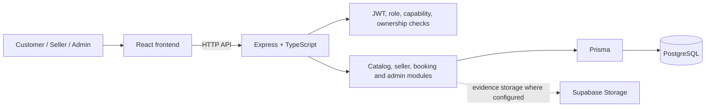

# Analisis dan Perancangan Sistem

## Metode dan batas bukti

Bagian ini merangkum analisis struktur dan kontrak yang tampak dalam repository. Metode pengumpulan kebutuhan pengguna, jumlah responden, instrumen, serta tanggal validasi belum tersedia: **[PERLU DATA DARI PEMILIK PROYEK]**. Karena itu, daftar kebutuhan berikut adalah kebutuhan sistem yang tercermin dari implementasi, bukan hasil survei.

## Aktor dan hak akses

- **Customer (`User`, `Role.USER`)**: mengakses akun sendiri, katalog publik, saved items, serta booking miliknya pada route yang tersedia.
- **Seller**: `User` yang mempunyai `SellerProfile`; beberapa operasi memerlukan seller yang telah disetujui. Seller bukan nilai terpisah pada enum `Role`.
- **Admin (`Role.ADMIN`)**: mengakses route administrasi yang dilindungi middleware admin.

Pemeriksaan backend tetap menjadi kontrol otoritatif; route frontend hanya mengatur pengalaman navigasi.

## Kebutuhan fungsional yang tercermin pada source

1. Sistem menyediakan registrasi, login, pembacaan dan pembaruan akun serta pemulihan sandi.
2. Pengunjung dapat membaca kategori, layanan publik, detail layanan, profil kreator dan facets.
3. Customer terautentikasi dapat mengelola favorites dan cart miliknya.
4. Seller dapat menyiapkan profil, portofolio, layanan, dan slot ketersediaan sesuai status/otorisasi.
5. Sistem mendukung validasi booking, lifecycle seller/customer, revisi, bantuan admin, pembatalan, sengketa, banding, serta pencatatan terkait.
6. Admin dapat melakukan keputusan pada workflow yang tersedia melalui API.

Tidak semua kebutuhan tersebut telah tersambung penuh ke UI. Status integrasi per fitur dijelaskan pada dokumentasi developer.

## Kebutuhan nonfungsional yang terlihat

- Validasi input menggunakan skema Zod pada route terkait.
- Endpoint terautentikasi menggunakan JWT dan middleware role/capability.
- Operasi pemilik dibatasi pada akun, seller, booking atau peserta yang sesuai.
- Koneksi database menerapkan TLS dengan CA dan verifikasi sertifikat ketat pada konfigurasi yang diaudit.
- Status dan keputusan lifecycle dikelola backend; frontend tidak menjadi sumber otoritatif.

Target performa, ketersediaan, aksesibilitas, usability, serta keamanan yang telah diuji secara formal: **[PERLU DATA DARI PEMILIK PROYEK]**.

## Arsitektur

Diagram menunjukkan hubungan logis berdasarkan source, bukan bukti deployment aktif.

## Desain data

Prisma schema memuat 62 model dan 40 enum. Domain utamanya mencakup akun/seller, katalog, saved items, booking dan siklus pengiriman, revisi, sengketa/banding, pembayaran, komunikasi, notifikasi, dan audit. Relasi yang penting antara lain `User`–`SellerProfile`, `SellerProfile`/`Category`–`Service`, `User`–`Favorite`/`CartItem`, dan `Booking` dengan customer, seller, service, delivery cycle, revision, dispute, serta review. Detail lengkap dan batas representasi ERD tersedia pada [Database Design](../technical/03-database-design.md) dan `prisma/schema.prisma`.

## Alur utama

Customer menelusuri layanan publik; seller menyiapkan profil dan penawaran serta menjalani aktivasi non-identitas; booking dibuat setelah validasi server; lifecycle dikelola oleh endpoint customer/seller dan scheduler; admin menangani review/moderasi/sengketa sesuai route. Revision admin assistance menghentikan response deadline pada status `OPEN`/`IN_REVIEW` dan melanjutkannya dengan sisa waktu persis setelah blocker berakhir, jika tidak ada blocker lain. Source mencatat perilaku ini; cakupan runtime untuk seluruh kombinasi konkurensi belum dibuktikan oleh dokumen ini.
