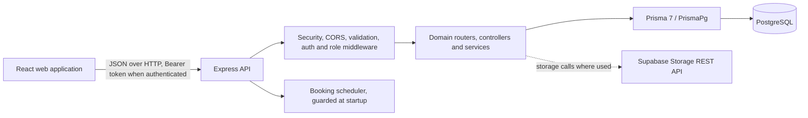

# DIGARSA — System Architecture

## Logical architecture

This is a logical view of source code. It does not imply that every external service or production deployment was exercised during the documentation work.

## Request paths

### Frontend

`frontend_fix/frontend/src/App.jsx` mounts React Router routes and `AuthProvider`. Feature adapters share `src/lib/apiClient.js`; it reads `VITE_API_BASE_URL` (default `http://localhost:3000`), sends JSON and, for authenticated calls, the stored Bearer token. Catalog, account, seller preparation/services, saved items, and booking adapters use this shared transport.

### Backend

`src/server.ts` loads runtime environment configuration, creates the listener, and initializes the guarded booking scheduler. `src/app.ts` installs middleware and mounts domain routers. Routers call controllers; request validation uses Zod and handlers/services use the shared Prisma client in `src/config/prisma.ts`.

## Technology inventory

Versions below come from package manifests/lockfiles as summarized by the audit. Node.js v24.19.0 was the audit process version, not a pinned application runtime declaration.

| Layer | Technology |
|---|---|
| Frontend UI | React / React DOM 19.3.1 |
| Frontend routing/build | React Router DOM 7.18.5; Vite 8.3.6; React Vite plugin 6.2.1 |
| Frontend mapping | Leaflet 1.9.4 |
| Backend HTTP | Node.js, TypeScript 5.9.3, Express 5.3.0, `tsx` 4.23.15 |
| Backend validation/security | Zod 4.6.7, Helmet 8.3.0, CORS 2.8.6, express-rate-limit 8.7.2, Multer 2.5.0 |
| Persistence | PostgreSQL; Prisma CLI/Client/adapter-pg 7.10.1; `pg` 8.23.1 |
| Authentication | `bcryptjs` 3.0.3; `jsonwebtoken` 9.0.3 |
| Storage integration | Supabase Storage REST calls from `src/lib/storage.ts` |

## Important directories

| Path | Responsibility |
|---|---|
| `src/app.ts`, `src/server.ts` | API setup, route mounting, listener and scheduler bootstrap. |
| `src/modules/` | Domain routers/controllers/services; several product areas are implemented across domain modules rather than one folder per feature. |
| `src/middleware/`, `src/lib/`, `src/config/` | Auth/upload middleware, shared utilities and Prisma runtime configuration. |
| `prisma/schema.prisma`, `prisma/migrations/` | Declarative data model and migration history. |
| `tests/` | Backend test files; package `test` script is currently a placeholder. |
| `frontend_fix/frontend/src/features/` | Frontend account, marketplace, seller, customer, and admin features. |

## Database and external services

The Prisma schema targets PostgreSQL. Runtime uses `DATABASE_URL` via `PrismaPg`; Prisma CLI uses `DIRECT_URL` from `prisma7.config.ts`. The runtime supplies the project CA with strict certificate verification; the CLI config uses strict SSL options and the CA path. Secret values are intentionally not documented here. Supabase Storage helpers use `SUPABASE_URL`, `SUPABASE_SERVICE_KEY`, and bucket-name variables for private evidence flows. Actual current deployment and storage availability require separate runtime verification.

## Background scheduler

`BOOKING_SCHEDULER_ENABLED=false` suppresses both initial scheduler execution and recurring scheduling; unset/default preserves the existing startup behavior. This option is intended for controlled local testing and is not a production configuration change. Scheduler jobs include booking delivery-cycle and overdue revision-assistance handling. See `src/lib/booking-scheduler-startup.ts` and `src/server.ts`.
