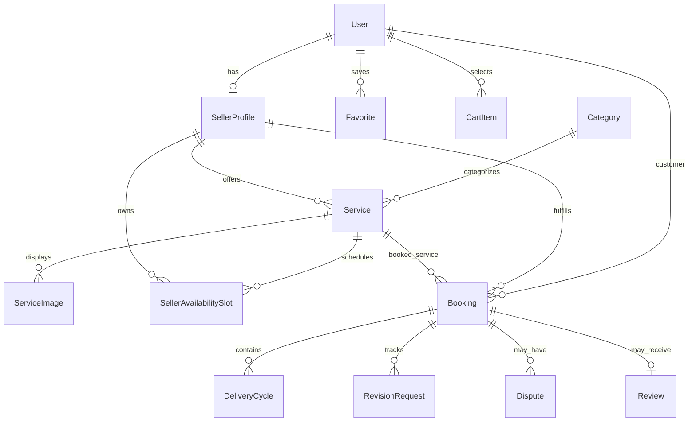

# DIGARSA — Database Design

## Source and scope

The authoritative model is [`prisma/schema.prisma`](../../prisma/schema.prisma). The audit identified 62 Prisma models, 40 enums, and 16 migration directories. These counts describe repository source; they do not assert that a particular live database has exactly that schema. No database introspection is claimed by this document.

## Model inventory by domain

The table lists all models from the audit. Field examples and relationships are representative; exact scalar types, optionality, referential actions, and indexes must be read from the schema itself.

| Domain | Models and responsibility |
|---|---|
| Accounts | `User` (account, role/status, profile/location, token version); `PasswordReset` (hashed reset/OTP state, attempts and expiry). `User.email` is unique. |
| Seller | `SellerProfile` (seller capability/profile, one-to-one with user); `SellerVerification` (legacy identity fields); `SellerActivationReview` (non-identity activation snapshots/hash/status/reviewer history; unique active seller key); `SellerUnavailableDate`; `SellerAvailabilitySlot`; `PortfolioItem`. |
| Catalog | `Category` (unique name/slug); `Service` (seller/category offer, price, delivery and revision policy, visibility/moderation/availability); `ServiceImage`. |
| Saved/catalog activity | `Favorite` and `CartItem` (user/service pairs with uniqueness); `ServiceView` (user/time-indexed views). |
| Booking and cancellation | `Booking` (customer, seller, service and booking snapshot); `BookingStatusEvent`; `BookingOperationReceipt`; `CancellationRequest` (reason/evidence/review state). |
| Booking timers/jobs | `BookingReviewTimer`; `BookingReviewPauseInterval`; `BookingReviewJob`; `DeliveryCycle`; `DeliveryCyclePauseInterval`; `DeliveryCycleJob`; `DeliveryCycleCompletionReceipt`. Delivery cycles are unique by booking/sequence; jobs and receipts have deduplication constraints. |
| Revision and assistance | `RevisionRequest`; `RevisionClarification`; `RevisionEvent`; `RevisionQuotaLedger`; `RevisionOperationReceipt`; `RevisionEscalationRequest`; `RevisionEscalationEvent`; `RevisionEscalationOperationReceipt`; `RevisionResponseClockPause`; `RevisionResponseClockResume`. Ledger/events/receipts preserve lifecycle evidence and idempotency boundaries. |
| Additional revision | `AdditionalRevisionRequest`; `AdditionalRevisionOfferVersion`; `AdditionalRevisionAgreement`; `AdditionalRevisionEvent`. This is a separate paid-additional-work contract. |
| Payment/finance | `PaymentTransaction`; `ProviderEventInbox`; `PaymentRefund`; `SellerPayout`; `FinancialLedgerEntry`; `Payment`. Their presence does not establish a configured gateway or working settlement/refund/payout flow. |
| Dispute and appeal | `Dispute`; `DisputeRevisionAuthorization`; `DisputeEvent`; `DisputeClarification`; `DisputeReportEvidence`; `DisputeMessageEvidence`; `DisputeEvidenceAccess`; `DisputeAppeal`; `DisputeAppealEvent`. |
| Reviews and communication | `Review`; `Conversation`; `Message`; `Notification`; `NotificationOutbox`. |
| Oversight | `Report`; `Feedback`; `ActivityLog`. A schema model alone does not prove a route or complete workflow exists. |

## Important relationships and constraints

- A `SellerProfile` belongs to a `User`; seller is not a value in `Role`.
- A `Service` relates to a seller profile and category; service images relate to services.
- Favorites and cart rows relate users to services and are unique by user/service. Cart is not a booking reservation.
- A `Booking` refers to customer, seller profile, and service; event, receipt, cancellation, timer, delivery cycle, revision, dispute, and review records extend that lifecycle.
- `DeliveryCycle` sequence uniqueness is per booking. Delivery job and completion receipt uniqueness support duplicate prevention.
- Revision quota operations use a ledger with operation/receipt constraints; the schema is not, by itself, proof of runtime concurrency guarantees.
- Seller activation review stores snapshots and hash; legacy identity verification is separate and is not the active non-identity activation rule.
- Payment/refund/payout/ledger models do not imply external provider integration or financial execution.

## ER diagram (selected relations)

Only relationships explicitly described in the reviewed schema inventory are shown. The diagram omits many supporting/event relations to remain readable; consult the Prisma schema for the complete relation graph.

## Enums

The 40 schema enums are: `Role`, `AccountStatus`, `VerificationStatus`, `SellerActivationReviewStatus`, `ModerationStatus`, `ServiceStatus`, `BookingStatus`, `PaymentStatus`, `PayoutStatus`, `AdditionalRevisionRequestStatus`, `AdditionalRevisionOfferStatus`, `AdditionalRevisionAgreementStatus`, `PaymentProvenance`, `PaymentRefundStatus`, `SellerPayoutStatus`, `FlagSeverity`, `NotificationType`, `ReportTarget`, `ReportStatus`, `CancellationRequestStatus`, `DisputeCategory`, `DisputeStatus`, `DisputeNextAction`, `DisputeClarificationRecipient`, `DisputeClarificationStatus`, `DisputeRevisionAuthorizationStatus`, `AppealStatus`, `AppealOutcome`, `BookingReviewJobStatus`, `DeliveryCycleStatus`, `DeliveryCycleJobStatus`, `RevisionStatus`, `RevisionClarificationStatus`, `RevisionClarificationRequester`, `RevisionQuotaOperation`, `RevisionEscalationTrigger`, `RevisionEscalationStatus`, `RevisionResponseClockType`, `RevisionEscalationActorType`, and `NotificationOutboxStatus`.

Notable status values include booking `REQUESTED`, `ACCEPTED`, `DECLINED`, `PAID`, `DELIVERED`, `COMPLETED`, `CANCELLED`; payment `PENDING`, `PAID`, `DEMO_PAID`, `FAILED`, `EXPIRED`, `REFUND_PENDING`, `REFUNDED`; and assistance `OPEN`, `IN_REVIEW`, `RESOLVED`, `CLOSED`. The schema remains the authority for every enum value and constraint.
