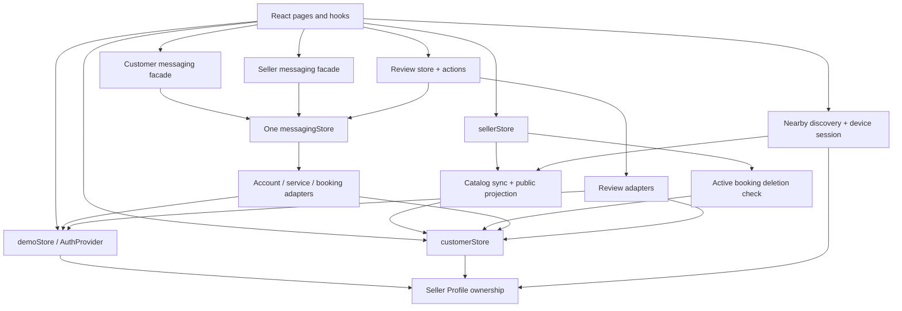

# Architecture and source-of-truth inventory

All behavior in this file is **Confirmed** unless labeled Proposed. Paths below are exact repository paths; links resolve to their source files. Do not use old milestone README future-work statements to override current code.

## Composition and route ownership

[frontend/src/App.jsx](../../src/App.jsx) mounts BrowserRouter → AuthProvider → one BookingNotifications observer → PublicLayout. Seller catalog initialization is imported once. [frontend/src/components/layout/PublicLayout.jsx](../../src/components/layout/PublicLayout.jsx) supplies the shared navbar/footer; public and private routes reuse it.

| Routes | Guard and primary consumers |
| --- | --- |
| `/`, `/marketplace`, `/service/:id`, `/seller/:id` | Public; HomePage, MarketplacePage, ServiceDetailPage, CreatorProfilePage |
| `/about`, `/how-it-works`, `/nearby` | Public lazy pages; no authentication required for discovery |
| `/login`, `/register` | AuthPage; safe return defaults to Homepage |
| `/become-a-creator` | RequireAccount; OnboardingPage redirects existing sellers to Seller Center |
| `/dashboard`, `/profile`, `/settings`, `/favorites`, `/cart` | RequireAccount; customer/account pages |
| `/saved` | RequireAccount; redirects to `/favorites` |
| `/booking/:serviceId`, `/orders`, `/orders/:bookingId` | RequireAccount; buyer-owned booking operations |
| `/reviews`, `/review/:bookingId` | RequireAccount; review queue/history and form; `?edit=1` selects edit |
| `/messages`, `/messages/:conversationId`, `/notifications` | RequireAccount plus customer facade authorization |
| `/seller-dashboard`, `/seller-dashboard/orders`, `/seller-dashboard/orders/:bookingId` | RequireSeller; overview and owned incoming orders |
| `/seller-dashboard/services`, `/seller-dashboard/services/new`, `/seller-dashboard/services/:serviceId/edit`, `/seller-dashboard/services/:serviceId/availability` | RequireSeller; services, publication and planning slots |
| `/seller-dashboard/messages`, `/seller-dashboard/messages/:conversationId`, `/seller-dashboard/notifications`, `/seller-dashboard/earnings`, `/seller-dashboard/profile` | RequireSeller plus store ownership |
| `/admin`, `/admin/accounts`, `/admin/moderation`, `/admin/orders` | RequireAdmin; overview, read-only accounts/orders, hide/restore services |
| Other paths | Public 404; nested seller/admin unknown paths redirect to their section root |

Exact nested definitions: [SellerCenter.jsx](../../src/features/seller/SellerCenter.jsx), [AdminCenter.jsx](../../src/features/admin/AdminCenter.jsx). Guards: [Guards.jsx](../../src/features/account/Guards.jsx). The return allowlist in [redirects.js](../../src/features/account/redirects.js) is independent of route matching; notably the actual per-service availability route is not covered by its nested seller pattern. Do not claim all nested URLs currently survive login; cover this in integration QA without weakening destination guards.

## Dependency map

Arrows are runtime dependencies, not independent network services. `messagingClient` binds the review notification resolver; review actions call shared messaging after review persistence. Preserve one instance and avoid introducing initialization/import cycles when replacing sync dependencies.

## Module inventory and replacement seams

### Accounts, profile and permissions

Source: [demoStore.js](../../src/features/account/demoStore.js), [AuthProvider.jsx](../../src/features/account/AuthProvider.jsx), [authContext.js](../../src/features/account/authContext.js), [profileValidation.js](../../src/features/account/profileValidation.js), [AuthPage.jsx](../../src/features/account/AuthPage.jsx), [OnboardingPage.jsx](../../src/features/account/OnboardingPage.jsx), [AccountMenu.jsx](../../src/features/account/AccountMenu.jsx), [accountNavigation.js](../../src/features/account/accountNavigation.js).

Public store methods:

- `current()`, `subscribe(listener)` — projected session user and change signal.
- `register({name,email,password})`, `login(email,password)`, `logout()` — account/session writes.
- `updateProfile(input,{expectedUserId})`, `changePassword({currentPassword,newPassword,confirmation},{expectedUserId})` — current-user updates only.
- `activateSeller(input)`, `getOwnedSeller(profileId)`, `updateSellerProfile(input)` — one profile per owner, same buyer identity.
- `listSellerProfiles()`, `getBookableSeller(profileId)` — profile projection versus stronger account-backed booking eligibility proof.
- `getBuyerLocation()`, `updateBuyerLocation(input,{expectedUserId})`, `clearBuyerLocation({expectedUserId})` — private current-account field only.
- `customerNames(ids)`, `customerIdentities(ids)` — seller/admin-gated display projections; caller supplies already-authorized booking/conversation participants. These are not unrestricted production account-search APIs.
- `listAccountsForAdmin()` — explicitly authorized summary, no credential fields.

Factory: `createDemoStore(storage,cryptoApi)` supplies the singleton `demoStore`.

Persistence: `digarsa.demo.accounts.v1`, version 1; accounts, profiles, active session. The account's private saved discovery field is not returned by `current()`, public profiles or admin summaries. Public capabilities are derived from a reciprocal owned profile; registration ignores role/permission injection. Password verification exists only as a browser demo; no public credential storage schema is proposed.

UI: [ProfilePage.jsx](../../src/features/profile/ProfilePage.jsx), [SettingsPage.jsx](../../src/features/profile/SettingsPage.jsx), [PersonalInfoForm.jsx](../../src/features/profile/PersonalInfoForm.jsx), [PasswordChangeForm.jsx](../../src/features/profile/PasswordChangeForm.jsx). Backend seam: session/current-user hydration and asynchronous account operations, preserving stable IDs and seller association. Profile contains personal/private location; Settings contains password/session/privacy controls.

### Catalog and service management

Source: [marketplace.js](../../src/data/marketplace.js), [home.js](../../src/data/home.js), [sellerStore.js](../../src/features/seller/sellerStore.js), [sellerClient.js](../../src/features/seller/sellerClient.js), [sellerCatalog.js](../../src/features/seller/sellerCatalog.js), [catalogSync.js](../../src/features/seller/catalogSync.js), [useCatalog.js](../../src/features/catalog/useCatalog.js), [CatalogNotice.jsx](../../src/features/catalog/CatalogNotice.jsx).

Public seller store: `snapshot()`, `subscribe(listener)`, `catalogEntries()`, `mine()`, `create(input)`, `update(id,input)`, `setAvailability(id,value)`, `setActive(id,bool)`, `remove(id)`, `schedulesFor(serviceId)`, `createSchedule(serviceId,input)`, `updateSchedule(serviceId,scheduleId,input)`, `removeSchedule(serviceId,scheduleId)`, `adminList()`, `moderate(id,{hidden,reason})`.

Factory: `createSellerStore(dependencies)` injects session, storage, base catalog and active-booking verification.

Persistence: `digarsa.demo.seller.v1`, version 1 `{services,schedules,moderation}`. Owner writes match both account ID and profile ID; moderation is separate. `remove` calls the injected verified active-booking counter before deleting service/schedules/moderation. Archive does not delete historical bookings. No booking slot reservation exists.

Catalog exports: mutable `services`, `creators`, `categories`, `locations`, helpers `money`, illustrative `rating`, `getCreator`, `getBaseServices`, `syncCatalog`. `createCatalogSync` prepares/validates before publication, `applyCatalog()` retries without repair; `catalogStatus.snapshot/subscribe/update` tracks `{error,hasValidCatalog,revision}`. Success mutates shared catalog arrays in place. Failures preserve last valid data and signal errors; first-load baseline arrays alone are not proof of catalog health. Nearby suppresses results on unhealthy catalog; direct booking also refuses it.

UI: [MarketplacePage.jsx](../../src/pages/marketplace/MarketplacePage.jsx), [ServiceDetailPage.jsx](../../src/pages/marketplace/ServiceDetailPage.jsx), [CreatorProfilePage.jsx](../../src/pages/marketplace/CreatorProfilePage.jsx), [ServiceFormPage.jsx](../../src/features/seller/ServiceFormPage.jsx), [SellerAvailabilityPage.jsx](../../src/features/seller/SellerAvailabilityPage.jsx). Marketplace URL fields `q,category,city,min,max,availability,sort`; sort `price-up|price-down|rating` or editor order. Ratings come from verified reviews, not mock testimonials. Backend seam: remote authoritative catalog with explicit stale/error state and DTO adaptation, never a silent fallback to editorial services.

### Customer lists, bookings and seller/admin order views

Source: [customerStore.js](../../src/features/customer/customerStore.js), [customerClient.js](../../src/features/customer/customerClient.js), [useCustomer.js](../../src/features/customer/useCustomer.js), [bookingLifecycle.js](../../src/features/customer/bookingLifecycle.js), [customerOverview.js](../../src/features/customer/customerOverview.js).

Public methods: `snapshot()`, `subscribe(listener)`, `view()`, `getBookingRestriction(serviceId)`, `addFavorite/removeFavorite/addToCart/removeFromCart(serviceId)`, `validateBooking(serviceId,input)`, `createBooking(serviceId,input,{confirmed,expectedUserId})`, `getBooking(id)`, `sellerView()`, `getActiveBookingCount(serviceId)`, `respondToBooking(id,action,{expectedStatus,reason})`, `adminView()`.

Factory: `createCustomerStore(dependencies)` injects session, storage, catalog/creator arrays, ownership resolver and catalog health. Additional exports `bookingRestriction`, `localToday`, `sellerActions`, `statuses` support validation/presentation.

Persistence: `digarsa.demo.customer.v1`, version 1 `{lists,bookings}`; one list per account with ID sets, one shared booking array. Customer reads filter current account; seller reads filter owned profile; admin monitoring requires explicit permission. Valid subsets may render with integrity warnings but mutations and deletion checks refuse unverifiable data. Booking creation and cart-item removal share one local write. No cancellation/pay setter or combined checkout.

UI: [BookingRequestPage.jsx](../../src/features/customer/BookingRequestPage.jsx), [BookingDetailPage.jsx](../../src/features/customer/BookingDetailPage.jsx), [OrdersPage.jsx](../../src/features/customer/OrdersPage.jsx), [DashboardPage.jsx](../../src/features/customer/DashboardPage.jsx), [FavoritesPage.jsx](../../src/features/customer/FavoritesPage.jsx), [CartPage.jsx](../../src/features/customer/CartPage.jsx), [SellerOrderDetailPage.jsx](../../src/features/seller/SellerOrderDetailPage.jsx). Backend seam: authenticated queries and atomic commands; preserve snapshots, dates, ownership, lifecycle and stale-state errors.

### Seller analytics and admin monitoring

Source: [useSeller.js](../../src/features/seller/useSeller.js), [sellerAnalytics.js](../../src/features/seller/sellerAnalytics.js), [earnings.js](../../src/features/seller/earnings.js), [SellerOverviewPage.jsx](../../src/features/seller/SellerOverviewPage.jsx), [EarningsPage.jsx](../../src/features/seller/EarningsPage.jsx), [useAdmin.js](../../src/features/admin/useAdmin.js), [AdminModerationPage.jsx](../../src/features/admin/AdminModerationPage.jsx).

Pure helpers: `summarizeSellerDashboard`, `aggregateBookingTrend`, `summarizeEarnings`, `summarizePerformance`. No analytics storage. KPIs use owned current booking statuses and service flags. Trend counts `createdAt` in viewer-local 7/30 daily or 12 monthly buckets; no invented revenue/travel/payment events. Completed estimate sums `estimatedPrice`. Performance: decided = not Requested; accepted = Accepted/Paid/Completed; response = decided/all, acceptance = accepted/decided, completion = Completed/accepted, zero denominator → 0. Earnings groups Completed by `updatedAt || createdAt`, not a payment ledger. Backend aggregation timezone and immutable status-event history need agreement.

Admin account filtering uses name/email/studio/profile ID and all/customer/seller/admin (customer includes sellers). Order monitoring filters status/customer/seller, search and inclusive UTC creation-date slices; its expanded rows currently expose private onsite location/brief to authorized admin. Moderation search includes title/category/creator; its hidden bucket includes both hidden and inactive services. Overview derives account/customer/seller counts, hidden/live/inactive services, active/completed bookings, seven-day request activity and completed estimate; no audit history is stored.

Admin reuses `listAccountsForAdmin`, `adminView`, `adminList`, `moderate`. No account suspension, seller verification, credential editing or admin booking transitions. Backend seam: limited admin summaries, server-checked permission and audited moderation.

### Shared chat and notifications

Source: [contracts.js](../../src/features/messaging/contracts.js), [messagingStore.js](../../src/features/messaging/messagingStore.js), [messagingClient.js](../../src/features/messaging/messagingClient.js), [adapters.js](../../src/features/messaging/adapters.js), [customerMessaging.js](../../src/features/messaging/customerMessaging.js), [customerMessagingClient.js](../../src/features/messaging/customerMessagingClient.js), [sellerMessaging.js](../../src/features/seller/sellerMessaging.js), [sellerMessagingClient.js](../../src/features/seller/sellerMessagingClient.js).

Shared public methods and exact records: [messaging-notifications.md](messaging-notifications.md). Customer facade: `listInbox`, `getThread`, `send`, `markRead`, `startService`, `startBooking`, `contactAvailability`, `listNotifications`, `markNotificationRead`, `counts`, `notifyRequested`. Seller facade: `listInbox`, `getThread`, `send`, `markRead`, `listNotifications`, `markNotificationRead`, `getUnreadNotificationCount`. They are stateless role views over one repository.

Persistence: `digarsa.demo.messaging.v1`, strict version 1 envelope with conversations/messages/notifications and internal dedup indexes. [bookingNotificationBridge.js](../../src/features/messaging/bookingNotificationBridge.js) observes seller status changes; [BookingNotifications.jsx](../../src/features/messaging/BookingNotifications.jsx) mounts it once. [NotificationBell.jsx](../../src/features/messaging/NotificationBell.jsx) shows customer notices only. UI [MessagingWorkspace.jsx](../../src/features/messaging/MessagingWorkspace.jsx) and [ConversationThread.jsx](../../src/features/messaging/ConversationThread.jsx) rely on synchronous reads/subscriptions. Backend seam: role-scoped queries, authorized commands, pagination and server event delivery replacing client observer writes.

### Reviews and location

Reviews: [reviewStore.js](../../src/features/reviews/reviewStore.js), [reviewClient.js](../../src/features/reviews/reviewClient.js), [reviewAdapters.js](../../src/features/reviews/reviewAdapters.js), [reviewActions.js](../../src/features/reviews/reviewActions.js), [reviewActionsClient.js](../../src/features/reviews/reviewActionsClient.js), [useReviews.js](../../src/features/reviews/useReviews.js). Methods: `subscribe`, `listPublic(filter)`, `getSummary(filter)`, `listOwn`, `listCompletedBookings`, `getEligibility(booking_id)`, `submit(input,{expected_user_id})`, `update(id,input,{expected_user_id})`, `getNotificationContext(id)`; pure `summarizeReviews`. Action wrapper `submit/update/retryNotification` separates successful save from notification errors. `digarsa.demo.reviews.v1` version 1 `{reviews}`, optional per-row `updated_at`. UI [ReviewsPage.jsx](../../src/features/reviews/ReviewsPage.jsx), [ReviewFormPage.jsx](../../src/features/reviews/ReviewFormPage.jsx), [PublicReviews.jsx](../../src/features/reviews/PublicReviews.jsx), [VerifiedRating.jsx](../../src/features/reviews/VerifiedRating.jsx). Replace with authoritative eligibility/publication and transactional aggregate/event handling.

Location: [locationModel.js](../../src/features/location/locationModel.js), [discovery.js](../../src/features/location/discovery.js), [deviceLocationSession.js](../../src/features/location/deviceLocationSession.js), [useDeviceLocation.js](../../src/features/location/useDeviceLocation.js), [useBuyerLocation.js](../../src/features/location/useBuyerLocation.js), [NearbyServicesPage.jsx](../../src/features/location/NearbyServicesPage.jsx), [LocationMap.jsx](../../src/features/location/LocationMap.jsx). Helpers: `validateCoordinates`, `parseCoordinates`, `validateBuyerLocation`, `validatePublicLocation`, `publicLocation`, `validStoredPublicLocation`, `publicLocationFromForm`, `haversineKm`, `requestBrowserLocation`, `discoverServices`. Device controller: `snapshot/subscribe/attach/retry/useManual/clear`. No separate location repository: saved private location on account, public location on seller/service; live point in RAM, sessionStorage attempt flag only. Backend seam: private preference API, sanitized public projections and non-persisting nearby query.

## Demo storage and test boundaries

All persistent demo keys are version 1. Messaging/review envelopes reject corrupt records rather than silently reset; customer/seller may return valid subsets **with errors**, then block writes; account validation is not as strict as messaging (e.g. falsy raw content becomes blank). Do not generalize the strictest validator to every store. None is a database, transaction across stores, trusted identity provider or cross-device source.

Relevant source documentation inspected: [account README](../../src/features/account/README.md), [profile README](../../src/features/profile/README.md), [customer README](../../src/features/customer/README.md), [seller README](../../src/features/seller/README.md), [messaging README](../../src/features/messaging/README.md), [customer messaging notes](../../src/features/messaging/CUSTOMER_UI.md), [reviews README](../../src/features/reviews/README.md), [location README](../../src/features/location/README.md). Older sections still describe delivered features as future work; this handoff uses actual routes and clients above.

Test sources: [accounts](../../tests/accounts.test.js), [profile](../../tests/profile.test.js), [customer](../../tests/customer.test.js), [seller](../../tests/seller.test.js), [stability](../../tests/frontend-stability.test.js), [messaging](../../tests/messaging.test.js), [customer messaging](../../tests/customer-messaging.test.js), [seller messaging](../../tests/seller-messaging.test.js), [reviews](../../tests/reviews.test.js), [location](../../tests/location.test.js), [device location](../../tests/device-location.test.js), [redirects](../../tests/redirects.test.js), [analytics](../../tests/seller-analytics.test.js), [account navigation](../../tests/account-menu.test.js), [customer presentation](../../tests/customer-presentation.test.js), [seller navigation](../../tests/seller-navigation.test.js). These are isolated unit/store integration tests, not deployed API or real GPS proof.

`customerStore.snapshot()` and `sellerStore.snapshot()` are raw storage synchronization primitives, not authorized business-data query endpoints. They may contain other accounts’ demo data; do not expose them or whole envelopes through the API. Public/private reads must use scoped projections described above.
