# Booking lifecycle and transaction handoff

## Confirmed state machine

Sources: [customerStore.js](../../src/features/customer/customerStore.js), [bookingLifecycle.js](../../src/features/customer/bookingLifecycle.js), [SellerOrderDetailPage.jsx](../../src/features/seller/SellerOrderDetailPage.jsx), [BookingDetailPage.jsx](../../src/features/customer/BookingDetailPage.jsx).

```mermaid
stateDiagram-v2
  [*] --> Requested: customer confirmed request
  Requested --> Accepted: owning seller accepts
  Requested --> Declined: owning seller declines
  Accepted --> Paid: future trusted payment confirmation only
  Paid --> Completed: owning seller completes
  Declined --> [*]
  Completed --> [*]
  Cancelled --> [*]: readable terminal state; no current transition command
```

The Accepted → Paid edge describes the intended lifecycle, **not an implemented frontend payment action**. There is no frontend pay command, automatic paid transition or Accepted → Completed shortcut. A structurally valid existing Paid demo record can be completed; browser storage cannot prove a real payment occurred.

| From | To | Actor | Implemented command and conditions |
| --- | --- | --- | --- |
| No booking | Requested | Current buyer (including sellers buying elsewhere) | `createBooking`; explicit confirmed review, expected current account, eligibility/brief checks; generated ID and server-derived snapshots in production |
| Requested | Accepted | Account owning booking's Seller Profile | `respondToBooking(id,"accept",{expectedStatus})`; target ownership and optional stale status check |
| Requested | Declined | Same seller | `respondToBooking(id,"decline",{expectedStatus,reason})`; optional trimmed reason ≤500 |
| Accepted | Paid | Future trusted payment service | **Not implemented**; backend must verify provider event, amount/currency/booking and replay safety before changing state |
| Paid | Completed | Same owning seller | `respondToBooking(id,"complete",{expectedStatus})`; current state Paid required |
| Any | Cancelled | Needs policy | **No current mutation**; renderer accepts Cancelled, no cancellation store method or UI action |
| Accepted | Completed | Nobody | Rejected |
| Declined/Cancelled/Completed | Any | Nobody in current model | Terminal; no reopen/reversal command |

`expectedStatus` is optional in the demo method; permitted transitions still enforce actual state. Proposed backend commands require `expected_status` and resource If-Match to protect concurrent/stale tabs. Admin monitoring has no transition authority. All commands must reject foreign booking IDs without exposing their details.

## New booking eligibility

`customerClient` injects `demoStore.getBookableSeller` and catalog health into the data layer, not just button state. At submission it checks:

1. Current account is a buyer; supplied expected account matches current session; confirmed review is true.
2. Reliable catalog; selected service exists, Open, valid delivery and finite nonnegative estimate, with creator metadata.
3. Seller Profile is unique, has required valid profile fields, and resolves to exactly one real account whose association points back to that profile. Fictional/editorial/orphaned/disassociated/duplicate owner/profile data is not enough.
4. Current account is neither seller owner nor the linked same Seller Profile. Admin permission does not bypass self-booking.
5. Requirements 10–2000 and description 20–5000 trimmed characters; canonical present/future date when required. Onsite requires date and location text 10–500. Remote ignores onsite address and date is optional unless `requiresSchedule` is explicitly true.

New records force Requested and snapshot title, seller name, initial estimate and delivery mode from the authoritative catalog. Caller-supplied status, price, names and ownership cannot select those values. Existing saved cart/favorites do not reserve price or availability; revalidate at final submission. A removed service may remain in historical bookings, reviews and booking-context chat.

## Availability and deletion

`Open/Full-book` is distinct from service publication `active` and moderation hidden state. Full-book can remain visible but cannot receive new requests; hidden/archived services leave public catalog. Existing bookings are not cancelled by these changes. Planning schedules reject overlaps, but bookings only record a requested date and do not reserve slots or capacity. Do not invent schedule selection semantics during integration.

`getActiveBookingCount(serviceId)` is a privileged seller operation over the same booking records, not a public count. Requested, Accepted and Paid are active. Malformed/inaccessible/incomplete booking storage or contradictory service-owner associations produce an error; they must **never** be interpreted as zero. Seller `remove` requires a verified nonnegative safe integer count and refuses deletion when positive. Demo deletion physically removes the service and its schedules/moderation; Proposed backend uses a tombstone/retained historical identity with equivalent active-booking protection. Archive remains a separate non-destructive publication operation.

## Proposed backend transaction boundaries

- **Create:** lock/verify service, seller ownership and visibility; snapshot price/mode/names; insert Requested; remove only current customer's selected cart entry; append immutable creation event and requested outbox entry; commit atomically. Idempotency-Key prevents duplicate POST requests. Validation preview is advisory only.
- **Accept/decline/complete:** lock owned booking, verify expected revision/status and allowed edge, update timestamp/reason, append transition event and uniquely keyed notification outbox entry, commit. No partial success that UI treats as rollback after delivery failure.
- **Pay:** future provider integration only, authenticated server-to-server confirmation with provider-event uniqueness, trusted amount/currency/order matching and replay protection. No endpoint accepting a buyer's `paid:true`. Payment settlement/refund/dispute behavior is undecided.
- **Delete vs create:** consistent locking/serialization prevents a booking appearing after a zero-active count check but before deletion. Referential integrity retains historical records. Unverifiable dependency → recoverable 503, not destructive fallback.
- **Review eligibility:** lock/check Completed and current associations; unique review per booking. No production fixture path to mark payment/completion.

## Tracking and privacy

Customer order queries are scoped by customer ID before returning data; seller queries use owned profile. Decline reasons appear only in the appropriate owned Declined context; missing legacy reason yields no invented reason. The private `location` text is an onsite brief/address, not the buyer's discovery GPS. Neither belongs in public catalog/chat notifications.

Timelines must describe Accepted as accepted and awaiting a future legitimate payment flow, Paid as already recorded paid state, Completed as completed. They must not fabricate stage timestamps: the current model has createdAt and optional updatedAt, not per-stage history. Proposed immutable status events enable future accurate timelines without inventing old events.

Regression anchors: [customer.test.js](../../tests/customer.test.js), [seller.test.js](../../tests/seller.test.js), [frontend-stability.test.js](../../tests/frontend-stability.test.js), [reviews.test.js](../../tests/reviews.test.js). In particular test Accepted completion rejection, Paid ownership/stale checks, active deletion failure, valid request creation, customer privacy and decline reason visibility.
